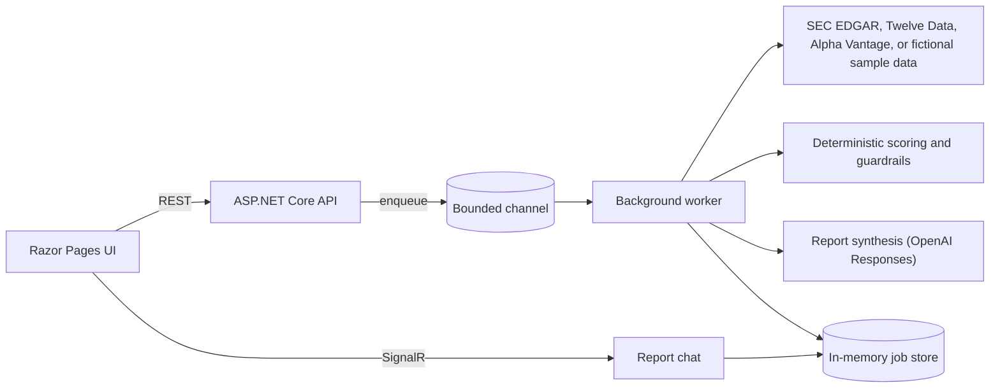

# Proofsheet

Built by **Eslam Hamed**, Technical Lead & AI Solutions Architect. More work: [eslamhamed.com](https://eslamhamed.com).

Proofsheet is an AI research analyst for US public companies, built with .NET 10. Give it a ticker and it reads the company's financial statements from its SEC filings, runs the research as a background job you can follow step by step, and returns a structured report. The report's thesis, insights and signal each cite sources from the report, and the backend refuses a citation that does not exist. You can then chat with the finished report: the chat model is given only that report and tools that read it.

> Proofsheet is a portfolio and research project. Nothing it produces is investment advice.

## Quick start

You don't need any API keys: without them, Proofsheet runs on four fictional sample companies whose figures are invented. You need the [.NET 10 SDK](https://dotnet.microsoft.com/download/dotnet/10.0).

```bash
git clone https://github.com/Eslam93/proofsheet.git
cd proofsheet
dotnet run --project Proofsheet.Api --launch-profile http
```

Open <http://localhost:5214>, pick a sample company, and generate a report. The API's Swagger UI is at <http://localhost:5214/swagger>. For more detail, see the [no-keys quickstart](docs/quickstart-no-keys.md).

To see real companies instead, still without keys, replay the SEC data recorded on 2026-11-06 for 14 companies. Every figure in those reports links to the 10-K it came from:

```bash
ResearchJobs__Mode=Recorded dotnet run --project Proofsheet.Api --launch-profile http
```

## What it does

- **Research jobs.** Submitting a ticker queues a job on a bounded in-process queue, and a hosted worker runs it. While it runs, the status endpoint reports each step, warning and source.
- **Data.** SEC EDGAR supplies company identity, the list of recent filings (form, date and link, not their text) and XBRL financial statements. Twelve Data (a market quote) and Alpha Vantage (news) are optional.
- **Reports.** Each report has a company, thesis, signal (Bullish, Neutral or Bearish), confidence, two to five insights and the source ids each one cites, plus which provider supplied each part of the data and whether it was live or sample data. Every financial figure taken from SEC data is listed with its XBRL concept, the period it covers and a link to the EDGAR filing it came from. With a model configured, the model writes the report through the OpenAI Responses API, and deterministic checks then bound its confidence and can overrule its signal. Without one, a deterministic template writes it.
- **A fixed research pipeline.** Resolve the company, collect five kinds of data in parallel, assess their quality, branch on gaps and contradictions, write the report, then check it.
- **Report chat.** A SignalR chat answers questions about the completed report. The model gets only the report and tools to look up its sources and trace steps; nothing checks its answers. Streaming resumes after a reconnect.
- **Run modes.**
  - `Mock`: the fictional sample companies, no keys.
  - `Hybrid`: live data. Where a provider fails, a real company's report leaves that part out; only the sample companies fall back to sample data.
  - `LiveRequired`: live data only.
  - `Recorded`: SEC data recorded on 2026-11-06 for 14 companies, replayed through the real SEC client and selection rule with no network calls, no keys and no model. Market data, news and chat are off. This is the mode for a public demo.
  - `Auto` (the default): picks Mock or LiveRequired depending on what is configured.

## How it works



The solution is split into layers:
- `Proofsheet.Domain`: models and deterministic scoring.
- `Proofsheet.Application`: orchestration and the job state machine.
- `Proofsheet.Infrastructure`: data providers, model clients, the queue and the stores.
- `Proofsheet.Api`: controllers, Razor Pages and the SignalR hub.

## Engineering notes

**Picking the right numbers out of SEC XBRL.** SEC company facts mix several kinds of figure:
- full fiscal years
- fourth quarters reported inside 10-Ks
- trailing-twelve-month figures reported inside 10-Qs
- restated years
- concepts companies have stopped using

The first version of Proofsheet used the first concept on a list and the two latest facts. Microsoft, for example, came out as fiscal 2010 with a 248% operating margin. On 2026-11-06 the two rules were run over 52 large companies and disagreed on at least one figure in 27 of the 35 statements the old rule could build. That count compared the rules with each other, not with the filings, and the data behind it was not kept, so it cannot be checked from this repository.

The fix is [`SecFactSelector`](Proofsheet.Infrastructure/Clients/SecFactSelector.cs):
- A fiscal year is a fact from an annual report that spans 350 to 380 days.
- Revenue comes from the concept the company still reports.
- Every other figure is pinned to that same fiscal year.

It is tested against trimmed real SEC data for 14 companies. The expected values come from a [separate JavaScript implementation](data/sec/reference.js) of the same rules, so the tests show that two implementations agree, not that the rules pick the right figures.

**Models inside guardrails.** The model writes the report, but the backend has the final say:
- Cited source IDs must exist.
- The number of insights and the confidence are bounded.
- Weak evidence forces a Neutral signal.

**Observable by design.** Every job records a trace of its steps, retries and fallbacks. Every report records which provider supplied each part of its data and whether it was live or sample data, and the report page says so above the signal.

## Configuration

Settings come from `Proofsheet.Api/appsettings.json`, environment variables, and user secrets. To run against live data, set these:

```bash
ResearchJobs__Mode=LiveRequired
SecEdgar__Enabled=true
SecEdgar__UserAgent="Proofsheet/1.0 you@example.com"   # SEC asks for contact details
TwelveData__Enabled=true
TwelveData__ApiKey=...
AlphaVantage__Enabled=true
AlphaVantage__ApiKey=...
OpenAiResponses__Enabled=true
OpenAiResponses__ApiKey=...
```

Every setting and its default is listed in the [reference](docs/reference.md#configuration).

## API

| Method | Path | Purpose |
|---|---|---|
| `POST` | `/api/v1/research-jobs` | Submit a job, for example `{ "identifier": "AAPL", "researchMode": "Standard", "asOf": "2026-11-06" }`. Only data filed on or before `asOf` (default: today) is used, so the same date gives the same figures. |
| `GET` | `/api/v1/research-jobs/{jobId}` | Status, current step, warnings and trace |
| `GET` | `/api/v1/research-jobs/{jobId}/result` | The finished report (`202` while the job runs) |
| `GET` | `/api/v1/tickers/search?q=ap` | Ticker and company search |
| `GET` | `/health` | Health check |
| SignalR | `/hubs/report-chat` | Report chat |

Errors are returned as RFC 7807 problem details.

## Tests

```bash
dotnet test Proofsheet.slnx
```

The unit and integration tests cover the real SEC fixtures, the fact-selection edge cases, the API and SignalR flows, the rate limits and the UI pages. They run without any keys, and the test host blanks any keys in your user secrets.

## Docker

```bash
docker build -t proofsheet .
docker run --rm -p 8080:8080 proofsheet
```

The image runs as a non-root user and listens on port 8080.

## Limitations

- Jobs, reports and chat threads are kept in memory and are lost on restart. A finished job is kept for 24 hours, and at most 500 jobs are kept at once. There is no authentication; each client address is rate limited instead.
- Live statements need the standard US GAAP concepts. Banks, oil majors and many pharmaceutical companies don't report operating income that way, so their statement is refused with a reason, and the job fails rather than show figures from anywhere else.
- The signal and confidence come from heuristics and a language model. Treat them as a demonstration, not a recommendation.
- An experimental *Autonomous* mode has a model coordinator call the same research tools and hand an evidence package to a specialist, which drafts, critiques and repairs the report. It has the thinnest tests and the most model calls, so it is offered only where a model is configured for live data, and it is not part of the demo.

## Roadmap

The direction is verifiability: every claim in a report should be checkable against the filing it came from.

- Read 10-K sections such as risk factors and MD&A, and cite claims down to the paragraph.
- Check every quoted passage and number in code before a report is shown.
- Run model evaluations in CI against recorded HTTP traffic, so they need no keys, and publish a static gallery of sample reports.
- Publish the container image from CI.

## Background

Proofsheet started as an implementation of the A.I.R.A case study, a take-home brief for an autonomous investment-research backend.
The [reference](docs/reference.md) keeps the full original documentation: architecture, job lifecycle, modes, the result contract and configuration.

## License

[MIT](LICENSE), by the [REUSE](https://reuse.software) convention: every file states its copyright and license, and CI checks it. The recorded SEC company facts in [`data/sec`](data/sec) are data the companies filed with the SEC, not the author's work, so they keep their own origin in [REUSE.toml](REUSE.toml).
