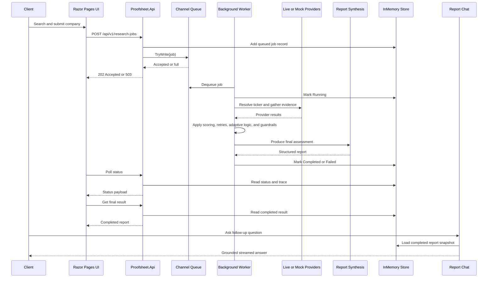

# Proofsheet reference

This is the full reference. For an overview and a quick start, see the [README](../README.md).

Proofsheet is an autonomous investment research backend built with .NET 10. It can analyze a publicly traded company, run the work asynchronously, show observable progress, return a structured report, and let the user chat with the completed report through a grounded OpenAI Responses flow.

The repository contains:

- a controller-based ASP.NET Core Web API
- a built-in Razor Pages UI
- a bounded background job pipeline
- mock, hybrid, and live execution paths
- a standard fixed workflow and an opt-in autonomous coordinator/specialist workflow
- report-grounded chat over SignalR

Proofsheet started as an implementation of the A.I.R.A case study, whose goal was to combine data retrieval, reasoning, structured outputs, and explainability in one backend service.

## Contents

- [What This Repo Does](#what-this-repo-does)
- [Current Product Shape](#current-product-shape)
- [Run Paths](#run-paths)
- [Architecture](#architecture)
- [Solution Structure](#solution-structure)
- [API Surface](#api-surface)
- [Job Lifecycle and Failure Behavior](#job-lifecycle-and-failure-behavior)
- [UI Flow](#ui-flow)
- [Research Modes](#research-modes)
- [Execution Modes](#execution-modes)
- [Agentic Workflow](#agentic-workflow)
- [Autonomous Mode](#autonomous-mode)
- [Data Sources](#data-sources)
- [Result Contract](#result-contract)
- [Report Chat](#report-chat)
- [Configuration](#configuration)
- [Run Locally](#run-locally)
- [Run With Live Providers](#run-with-live-providers)
- [Run Autonomous Mode](#run-autonomous-mode)
- [Run With Docker](#run-with-docker)
- [Testing and Validation](#testing-and-validation)
- [Trade-offs](#trade-offs)
- [Known Limitations](#known-limitations)
- [Extra Docs](#extra-docs)

## What This Repo Does

At a high level, Proofsheet supports this flow:

1. Search for a company or ticker.
2. Submit a research job.
3. Run the job asynchronously in the background.
4. Poll status and render live progress and trace.
5. Produce a structured investment-style JSON report.
6. Let the user chat with the completed report only.

The system is intentionally:

- unauthenticated
- in-memory
- non-durable across restarts
- reviewable and demo-friendly
- configurable from fully local mock mode up to live-provider plus model-backed mode

## Current Product Shape

The current implementation includes:

- async job submission and status polling
- a built-in web UI for submission, progress, report review, and chat
- structured JSON result output
- safe structured trace output
- provider provenance in the final report
- report-grounded chat over SignalR
- execution modes for `Mock`, `Hybrid`, `LiveRequired`, and `Auto`
- research modes for `Standard` and `Autonomous`
- any-US-ticker lookup through SEC mapping in the live path
- OpenAI Responses-based report synthesis, chat, coordinator, and specialist roles

## Run Paths

There are three practical ways to run the system.

### 1. No-key local demo path

Use this if you just cloned the repository and want the simplest working path.

- `ResearchJobs:Mode = Auto`
- `OpenAiResponses:Enabled = false`
- live providers disabled

Result:

- `Auto` resolves to `Mock`
- the built-in UI works
- the API works
- reports generate successfully for the four fictional sample companies
- every report is labelled as fictional sample data
- report chat stays disabled
- autonomous mode should not be used

See [quickstart-no-keys.md](./quickstart-no-keys.md).

### 2. Live standard path

Use this when you want live provider data and model-authored final reports.

- `ResearchJobs:Mode = LiveRequired` or `Auto`
- OpenAI Responses configured
- SEC, Twelve Data, and Alpha Vantage configured
- `researchMode = Standard`

Result:

- provider retrieval is live
- report synthesis is model-authored
- deterministic scoring still acts as a guardrail layer
- chat is available once the report completes

### 3. Autonomous path

Use this when you want the more agentic coordinator/specialist flow.

- OpenAI Responses configured
- `researchMode = Autonomous`
- execution mode typically `LiveRequired` or `Hybrid`

Result:

- a coordinator agent decides tool order and revisits
- explicit evidence-gap review is performed
- a specialist agent produces the final report
- critique and repair occur before final backend validation

## Architecture

The app is a single ASP.NET Core process with several runtime layers:

1. HTTP and UI layer
   - controllers
   - Razor Pages
   - SignalR hub
   - Swagger
   - global exception middleware
2. Application layer
   - validation
   - job submission and querying
   - orchestration
   - state transitions
   - result assembly
3. Domain layer
   - provider contracts
   - reasoner contracts
   - enums and domain models
   - deterministic scoring contracts
4. Infrastructure layer
   - in-memory job store
   - in-memory chat thread store
   - in-memory autonomous session store
   - bounded channel queue
   - live and mock providers
   - OpenAI Responses adapters
   - hosted worker
   - configuration binding

Core runtime sequence:

1. Submit request hits the API.
2. Identifier is validated and normalized.
3. A queued job record is written to the in-memory store.
4. The job is admitted to a bounded `Channel<T>` with `TryWrite`.
5. A hosted background worker dequeues and processes the job in a fresh DI scope.
6. The processor resolves execution mode and research mode.
7. Data is gathered from the configured source stack.
8. Deterministic assessment metrics are computed as guardrails.
9. The configured synthesis flow produces the final report.
10. The result is written back to the store.
11. The UI polls the status endpoint and renders the trace.
12. Once complete, chat can open against that exact stored report snapshot.

## Solution Structure

- `Proofsheet.Api`
  - controllers
  - Razor Pages UI
  - SignalR hub
  - middleware
  - prompt files
  - composition root
- `Proofsheet.Application`
  - orchestration
  - submission/query services
  - state machine
  - result/status models
  - report-chat orchestration
  - autonomous orchestration
- `Proofsheet.Domain`
  - provider contracts
  - reasoner contracts
  - enums
  - domain models
  - deterministic scoring services
- `Proofsheet.Infrastructure`
  - live provider clients
  - mock providers
  - queue/store implementations
  - hosted worker
  - Responses integrations
  - prompt providers
  - execution-mode resolution
  - ticker directory resolution
- `Proofsheet.Tests.Unit`
  - validation
  - scoring
  - submission semantics
  - provider behavior
  - prompt loading
  - report chat services
  - autonomous coordinator logic
- `Proofsheet.Tests.Integration`
  - API flows
  - UI rendering
  - SignalR chat flows

## API Surface

### Business endpoints

- `POST /api/v1/research-jobs`
- `GET /api/v1/research-jobs/{jobId}`
- `GET /api/v1/research-jobs/{jobId}/result`
- `GET /api/v1/tickers/search?q=...&limit=10`

### Operational endpoint

- `GET /health`

### SignalR endpoint

- `/hubs/report-chat`

### Submit a job

Request:

```json
{
  "identifier": "AAPL",
  "researchMode": "Standard"
}
```

Notes:

- `identifier` is required
- `researchMode` is optional
- allowed research modes are `Standard` and `Autonomous`
- if omitted, `Standard` is used
- `asOf` is optional (`yyyy-MM-dd`, default today): only SEC facts filed on or before that date are read, and the staleness check measures from it, so the same date gives the same figures. A future date, or one before 2009-06-15 when XBRL data begins, is refused with `400`. The completed report records it as `asOf`.

Success returns `202 Accepted`:

```json
{
  "jobId": "3f0f2b1d-92b4-4e77-8d7f-9c3a8d58e2aa",
  "status": "Queued",
  "createdAtUtc": "2026-03-18T10:00:00Z",
  "statusUrl": "/api/v1/research-jobs/3f0f2b1d-92b4-4e77-8d7f-9c3a8d58e2aa",
  "resultUrl": "/api/v1/research-jobs/3f0f2b1d-92b4-4e77-8d7f-9c3a8d58e2aa/result"
}
```

### Job status

`GET /api/v1/research-jobs/{jobId}`

Returns a status document that includes:

- job identity
- timestamps
- current step
- warnings
- live trace snapshot
- error if failed
- `researchMode`
- `activeAgent`
- `agentPhase`

Example:

```json
{
  "jobId": "3f0f2b1d-92b4-4e77-8d7f-9c3a8d58e2aa",
  "identifier": "AAPL",
  "status": "Running",
  "createdAtUtc": "2026-03-18T10:00:00Z",
  "startedAtUtc": "2026-03-18T10:00:01Z",
  "completedAtUtc": null,
  "currentStep": "QualityAssessment",
  "warnings": [],
  "trace": [],
  "error": null,
  "correlationId": "2b6b6f1e2d0445d59de16d7c2a3343eb",
  "researchMode": "Standard",
  "activeAgent": "None",
  "agentPhase": ""
}
```

### Job result

`GET /api/v1/research-jobs/{jobId}/result`

Returns:

- `202 Accepted` while queued or running
- `200 OK` with the completed report
- `409 Conflict` with `ProblemDetails` when the job failed
- `404 Not Found` with `ProblemDetails` when the job does not exist

### Ticker search

`GET /api/v1/tickers/search?q=ap&limit=10`

Example response:

```json
{
  "items": [
    {
      "symbol": "AAPL",
      "companyName": "Apple Inc.",
      "exchange": "Nasdaq",
      "cik": "0000320193"
    }
  ]
}
```

Notes:

- minimum query length is `2`
- the default limit is `10`
- the maximum limit is `20`

## Job Lifecycle and Failure Behavior

Public job states:

- `Queued`
- `Running`
- `Completed`
- `Failed`

Allowed transitions:

- `Queued -> Running`
- `Running -> Completed`
- `Running -> Failed`

Queue behavior:

- the queue is a bounded `Channel<ResearchJobQueueItem>`
- API admission uses `TryWrite`
- request threads never wait for queue capacity
- if the queue is full, the API returns `503 Service Unavailable`
- the provisional job record is removed if queue admission fails

Status and result behavior:

- `GET /api/v1/research-jobs/{jobId}` returns the latest state, step, warnings, live trace, and mode metadata
- `GET /api/v1/research-jobs/{jobId}/result` returns `202` until a terminal state exists
- failed jobs return `409` with `ProblemDetails`
- unknown jobs return `404`
- invalid request payloads return `400`
- unresolved or unsupported identifiers return `422`

Timeout behavior:

- `ResearchJobs__JobTimeoutMs` defaults to `90000`
- live jobs enforce a minimum effective timeout of 90 seconds so provider retrieval and synthesis are not cut off too aggressively

All non-success API errors use RFC 7807 `ProblemDetails`.

## UI Flow

The built-in UI is served from `Proofsheet.Api` and is part of the same app.

### Pages

- `/`
  - company search
  - research mode selection
  - job submission
- `/reports/{jobId}`
  - live progress
  - report rendering
  - provider provenance
  - progress drawer
  - grounded chat once the report is ready

### UX sequence

1. Search for a company or ticker.
2. Choose `Standard` or `Autonomous`.
3. Submit the job.
4. Watch the progress bar, current status, and trace timeline.
5. Review the completed report.
6. Chat with the report once the thread is ready.

The status page keeps the progress panel secondary so the report remains the main focus after completion.

## Research Modes

Research mode controls how the report is orchestrated.

### `Standard`

This is the stable fixed pipeline.

It always follows the same high-level sequence:

1. identifier resolution
2. research plan creation
3. source collection
4. quality assessment
5. adaptive branching
6. synthesis
7. final reflection
8. completion

Use `Standard` when:

- running without keys
- demonstrating the simplest path
- you want predictable orchestration

### `Autonomous` (experimental)

This is the experimental multi-agent path. It has the thinnest tests and the most model calls, so the UI offers it only where a model is configured for live data, and it is not part of the demo.

It uses:

- a Responses-based coordinator agent
- bounded internal tools only
- explicit evidence-gap review
- specialist handoff
- specialist critique and repair

Use `Autonomous` when:

- OpenAI Responses is configured
- you want to demonstrate stronger agent behavior
- you want the coordinator/specialist handoff flow

## Execution Modes

Execution mode controls the provider and fallback strategy.

### `Mock`

- use the fictional sample companies only; any other identifier gets no report
- deterministic and no-key friendly

### `Hybrid`

- prefer live providers
- when a provider fails, a real company's report leaves that part out, and the job fails if the missing part is the company profile or the financial statements
- only the fictional sample companies fall back to sample data, and that fallback is explicit in provenance and trace

### `LiveRequired`

- use live providers only
- seeded fallback is disabled for main report generation
- critical live-source failure fails the job
- non-critical live-source failure degrades the report

### `Recorded`

- replays the SEC company facts in `data/sec/2026-11-06` through the real SEC client and selection rule; the recording is copied next to the app as `RecordedData/Sec`
- makes no network call and needs no key: the SEC client's HTTP handler answers from the recording, and Twelve Data, Alpha Vantage and OpenAI are never called
- only the recorded companies resolve; reports are built as of the recording date (`ResearchJobs__RecordedOn`, default `2026-11-06`), and a later as-of date is refused
- market data, news and the list of recent filings were not recorded, so each report says they are missing; with that much missing, the backend forces a `Neutral` signal
- a template writes the report and chat is off, even if a model key is configured
- provenance shows the origin `Recorded` and the provider `SEC EDGAR, recorded 2026-11-06`

### `Auto`

Default behavior:

- resolve to `Mock` when the live provider stack or report-synthesis model is not fully configured
- resolve to `LiveRequired` when the live and model stack is configured

This makes the repo safe for fresh local clones while still allowing full live execution in configured environments.

## Agentic Workflow

The standard workflow uses these public step names:

1. `IdentifierResolution`
2. `ResearchPlanCreation`
3. `ParallelSourceCollection`
4. `QualityAssessment`
5. `AdaptiveBranching`
6. `Synthesis`
7. `FinalReflection`
8. `Completion`

Trace-only special steps:

- `ProviderRetry`
- `ProviderFallback`

The standard flow is still genuinely multi-step:

- it decides what domains are needed
- it collects from multiple sources independently
- it adapts to missing data, retries, contradictions, and low-news conditions
- it synthesizes the final report only after the evidence package is assembled

## Autonomous Mode

Autonomous mode adds a more model-driven orchestration path.

### Coordinator role

The coordinator:

- resolves the ticker
- decides tool order
- revisits tools when needed
- gathers evidence
- reviews evidence gaps
- decides when to hand off

Approved internal tools are bounded to the tool registry. There is no open web browsing.

Tool catalog:

- `resolveTicker`
- `getCompanyProfile`
- `getMarketSnapshot`
- `getFinancialStatements`
- `getNewsCoverage`
- `getFilingCoverage`
- `getEvidenceStatus`
- `handoffToSpecialist`

### Specialist role

The specialist receives a handoff packet only. It does not call live-provider tools directly.

The handoff packet includes:

- resolved company identity
- evidence summary
- source catalog and provenance
- warnings and missing-source notes
- deterministic guardrail metrics
- coordinator plan summary
- unresolved questions and contradictions

The specialist is responsible for:

- `signal`
- `confidence`
- `thesis`
- `insights`
- `thesisDetails`
- `insightDetails`
- `signalDetails`
- `confidenceDetails`

### Reflection phases

Autonomous trace phases include:

- `CoordinatorPlanning`
- `CoordinatorToolExecution`
- `EvidenceGapReview`
- `ContradictionReview`
- `SpecialistHandoff`
- `SpecialistDraft`
- `SpecialistCritique`
- `OutputValidation`

### Validation authority

Even in autonomous mode, backend validation remains final authority:

- cited source ids must exist
- `signal` must be valid
- `confidence` must be `0..100`
- `insights` must be between `2` and `5`
- `evidenceScore < 55` forces a final backend `Neutral` override
- confidence is bounded by deterministic guardrails

## Data Sources

### Live sources

- SEC EDGAR
  - ticker resolution
  - company identity
  - filings
  - most financial statements
- Twelve Data
  - market snapshot
- Alpha Vantage
  - news coverage

### Sample data

The sample catalog has four fictional companies. Their names, figures, headlines and filing excerpts are invented, and their identifiers are longer than any US ticker, so none can be mistaken for a listed company:

- `NORTHWIND`, Northwind Instruments (fictional)
- `FABRIKAM`, Fabrikam Software (fictional)
- `TAILSPIN`, Tailspin Semiconductors (fictional)
- `CONTOSO`, Contoso Motors (fictional)

There is no sample data for real companies. In `Mock` mode, the app is fully deterministic and does not need external APIs.

### CONTOSO degraded scenario

`CONTOSO` is the degraded sample path and behaves as follows per job execution:

- market snapshot fails once with `TransientFailure`
- retry succeeds
- news coverage is sparse and low quality
- final signal becomes `Neutral`

Required warnings include:

- `Market snapshot required retry before successful retrieval.`
- `Low news coverage reduced narrative confidence.`

## Result Contract

Every completed report includes the original required top-level keys:

```json
{
  "company": "...",
  "thesis": "...",
  "signal": "...",
  "insights": [],
  "sources": []
}
```

The current implementation extends that schema with rich explainability data.

### Current completed result shape

```json
{
  "company": "Northwind Instruments (fictional)",
  "identifier": "NORTHWIND",
  "thesis": "Northwind Instruments (fictional) combines high margins and recurring service revenue support resilient cash generation with recent coverage remains anchored by service revenue keeps growing faster than hardware, while Valuation remains sensitive to the next product cycle remains the main offset.",
  "signal": "Bullish",
  "confidence": 92,
  "generatedAtUtc": "2026-11-18T18:22:55Z",
  "insights": [
    "Northwind Instruments (fictional) is converting revenue into strong cash generation and operating leverage.",
    "Recent coverage remains constructive, led by themes such as service revenue keeps growing faster than hardware.",
    "Primary risk remains Valuation remains sensitive to the next product cycle, but the current evidence still favors upside."
  ],
  "sources": [
    "financials:NORTHWIND",
    "profile:NORTHWIND",
    "filing:NORTHWIND:001",
    "news:NORTHWIND:001"
  ],
  "warnings": [],
  "trace": [],
  "sourceDetails": [],
  "providerUsage": [],
  "insightDetails": [],
  "thesisDetails": {
    "summary": "Thesis rests on strong financial execution, company positioning, and corroborating disclosures.",
    "sourceIds": [
      "financials:NORTHWIND",
      "profile:NORTHWIND",
      "filing:NORTHWIND:001"
    ]
  },
  "signalDetails": {
    "signal": "Bullish",
    "rationale": "Positive directional evidence outweighed the risks across the strongest sources (financials:NORTHWIND, profile:NORTHWIND, filing:NORTHWIND:001, news:NORTHWIND:001).",
    "sourceIds": [
      "financials:NORTHWIND",
      "filing:NORTHWIND:001"
    ],
    "overrideApplied": false
  },
  "confidenceDetails": {
    "rationale": "Confidence reflects completeness 100, evidence quality 84, agreement 86, and support coverage 100.",
    "boundedFrom": 92,
    "boundedTo": 92,
    "sourceIds": [
      "financials:NORTHWIND",
      "profile:NORTHWIND",
      "filing:NORTHWIND:001"
    ]
  },
  "synthesisDetails": {
    "mode": "Mock",
    "model": "deterministic",
    "validationRetries": 0,
    "fallbackOccurred": false
  },
  "orchestrationDetails": {
    "researchMode": "Standard",
    "coordinatorModel": null,
    "specialistModel": null,
    "handoffOccurred": false,
    "toolCallCount": 0,
    "reflectionRounds": 0,
    "validationRetries": 0
  }
}
```

The example is a `Mock` run for a fictional sample company: a deterministic template wrote it, and every figure behind it is invented. A model-written report has the same shape, with the model's name in `synthesisDetails`.

### Provenance and traceability

The result explicitly captures:

- `providerUsage`
  - one entry per domain
  - origin, provider name, fallback state, and fallback reason
- `sourceDetails`
  - source type, title, timestamp, provider origin, provider name, fallback state
- `insightDetails`
  - source ids for each insight
- `thesisDetails`
  - source ids supporting the thesis
- `signalDetails`
  - signal rationale and whether an override was applied
- `confidenceDetails`
  - confidence rationale and the bounded range
- `synthesisDetails`
  - synthesis mode, model, retries, fallback state
- `orchestrationDetails`
  - standard vs autonomous orchestration metadata
- `asOf`
  - the date the report was built as of: only SEC facts filed on or before it were read
- `figures`
  - every reported figure behind the financial statement: label, value in US dollars, XBRL concept, period, form, accession number, filing date and the EDGAR filing index URL. Empty for sample data, which has no filings.

### Trace semantics

Each trace item includes:

- `step`
- `status`
- `summary`
- `sourceIds`
- `timestampUtc`

Trace entries are intentionally safe:

- they expose what the system did
- they do not expose hidden chain-of-thought

## Report Chat

The report chat is a separate Responses-based layer on top of a completed report.

### Design rules

- chat is available only for completed jobs
- each chat thread is app-owned
- each chat thread is bound to one completed report snapshot
- chat does not trigger fresh research
- chat does not browse the web
- the chat model is given only the completed report and tools that read it; nothing checks its answers against the report

### Transport

- SignalR hub: `/hubs/report-chat`

Hub methods:

- `CreateThread(Guid jobId)`
- `SendMessage(string threadId, string message)`
- `ResumeStream(string threadId, long lastSequence)`
- `CancelStream(string threadId)`

### Grounding tools

The chat model can use:

- `getReportSummary()`
- `getSourceDetails(sourceIds[])`
- `getInsightEvidence(insightIndexes[])`
- `getTrace(step?, limit?)`
- `getProviderUsage()`

### Thread behavior

- in-memory only
- expires after `60` minutes of inactivity
- stores transcript and `previousResponseId`
- survives within the running app only
- a message is at most 1,000 characters
- each client address may open threads and send messages 30 times an hour in total

### Errors

The browser never sees an upstream error. When the model provider or anything else fails, the chat sends a fixed sentence with a reference id, and the server logs the original error under the same id.

## Configuration

Configuration comes from:

- `Proofsheet.Api/appsettings.json`
- `Proofsheet.Api/appsettings.Development.json`
- environment variables
- `.env.example`
- ASP.NET user-secrets if you choose to use them locally

### Main settings

#### Research jobs

- `ResearchJobs__QueueCapacity`
- `ResearchJobs__MaxConcurrentJobs`
- `ResearchJobs__ProviderTimeoutMs`
- `ResearchJobs__RetryDelayMs`
- `ResearchJobs__MaxRetries`
- `ResearchJobs__JobTimeoutMs`
- `ResearchJobs__OverloadRetryAfterSeconds`
- `ResearchJobs__Mode`
- `ResearchJobs__TickerSearchMinimumQueryLength`
- `ResearchJobs__TickerSearchDefaultLimit`
- `ResearchJobs__TickerSearchMaxLimit`
- `ResearchJobs__JobRetentionMinutes` (default `1440`): how long a finished job stays readable
- `ResearchJobs__MaxStoredJobs` (default `500`): the oldest finished jobs are dropped first when the store is full

#### Rate limits

Every limit counts requests from one client address in a fixed window.

- `RateLimiting__Enabled` (default `true`)
- `RateLimiting__RequestsPerMinute` (default `120`): any request except static files
- `RateLimiting__JobSubmissionsPerHour` (default `20`)
- `RateLimiting__ChatRequestsPerHour` (default `30`): chat threads opened plus messages sent
- `RateLimiting__ClientAddressHeader` (default empty): a header such as `CF-Connecting-IP` that a reverse proxy sets to the client's address. Set it only when the app cannot be reached except through that proxy, because anyone who reaches the app directly can put any address in the header. When it is empty, the connection's remote address is used.

A refused request gets `429 Too Many Requests` with `Retry-After` and problem details; a refused chat request gets a fixed chat error.

#### OpenAI Responses

- `OpenAiResponses__Enabled`
- `OpenAiResponses__ApiKey`
- `OpenAiResponses__BaseUrl`
- `OpenAiResponses__Model`
- `OpenAiResponses__ReportModel`
- `OpenAiResponses__ChatModel`
- `OpenAiResponses__CoordinatorModel`
- `OpenAiResponses__SpecialistModel`
- `OpenAiResponses__TimeoutSeconds`
- `OpenAiResponses__EnableStreaming`
- `OpenAiResponses__MaxToolRounds`
- `OpenAiResponses__PromptFilePath`
- `OpenAiResponses__ReportPromptFilePath`
- `OpenAiResponses__ChatPromptFilePath`
- `OpenAiResponses__CoordinatorPromptFilePath`
- `OpenAiResponses__SpecialistPromptFilePath`
- `OpenAiResponses__ReportValidationRetries`
- `OpenAiResponses__CoordinatorMaxToolRounds`
- `OpenAiResponses__SpecialistCritiqueRetries`
- `OpenAiResponses__AllowAutonomousStandardFallback`

#### SEC EDGAR

- `SecEdgar__Enabled`
- `SecEdgar__DataBaseUrl`
- `SecEdgar__MappingUrl`
- `SecEdgar__UserAgent`

#### Twelve Data

- `TwelveData__Enabled`
- `TwelveData__BaseUrl`
- `TwelveData__ApiKey`

#### Alpha Vantage

- `AlphaVantage__Enabled`
- `AlphaVantage__BaseUrl`
- `AlphaVantage__ApiKey`

### Important defaults

- `ResearchJobs__Mode = Auto`
- `OpenAiResponses__Enabled = false`
- live providers disabled by default
- `ResearchJobs__JobTimeoutMs = 90000`
- `OpenAiResponses` default models are `gpt-5.4-nano`

### Example hybrid-live setup

```bash
ResearchJobs__Mode=Hybrid
SecEdgar__Enabled=true
SecEdgar__UserAgent="Proofsheet/1.0 you@example.com"
TwelveData__Enabled=true
TwelveData__ApiKey=your_twelve_data_key
AlphaVantage__Enabled=true
AlphaVantage__ApiKey=your_alpha_vantage_key
```

### Example live-required setup

```bash
ResearchJobs__Mode=LiveRequired
OpenAiResponses__Enabled=true
OpenAiResponses__ApiKey=your_openai_key
OpenAiResponses__ReportModel=gpt-5.4-nano
OpenAiResponses__ChatModel=gpt-5.4-nano
SecEdgar__Enabled=true
SecEdgar__UserAgent="Proofsheet/1.0 you@example.com"
TwelveData__Enabled=true
TwelveData__ApiKey=your_twelve_data_key
AlphaVantage__Enabled=true
AlphaVantage__ApiKey=your_alpha_vantage_key
```

### Example autonomous setup

```bash
ResearchJobs__Mode=LiveRequired
OpenAiResponses__Enabled=true
OpenAiResponses__ApiKey=your_openai_key
OpenAiResponses__CoordinatorModel=gpt-5.4-nano
OpenAiResponses__SpecialistModel=gpt-5.4-nano
OpenAiResponses__AllowAutonomousStandardFallback=false
SecEdgar__Enabled=true
SecEdgar__UserAgent="Proofsheet/1.0 you@example.com"
TwelveData__Enabled=true
TwelveData__ApiKey=your_twelve_data_key
AlphaVantage__Enabled=true
AlphaVantage__ApiKey=your_alpha_vantage_key
```

## Run Locally

### Fastest no-key path

From the repository root:

```bash
dotnet restore
dotnet build Proofsheet.slnx
dotnet run --project Proofsheet.Api --launch-profile http
```

Open:

- `http://localhost:5214/`
- `http://localhost:5214/swagger`
- `http://localhost:5214/health`

Recommended for this path:

- choose `Standard`
- keep defaults
- expect mock-backed reports
- expect chat to remain disabled

### Development URLs

Current launch profiles:

- `http://localhost:5214`
- `https://localhost:7004`

If you use the `https` profile, trust the development certificate once with `dotnet dev-certs https --trust`, and run it again after moving to the .NET 10 SDK.

## Run With Live Providers

To get live provider data, configure:

- `SecEdgar`
- `TwelveData`
- `AlphaVantage`

Recommended mode:

- `ResearchJobs__Mode = LiveRequired`

Notes:

- SEC requires a valid `User-Agent`
- live provider failures can fail or degrade the report depending on criticality
- `LiveRequired` disables seeded fallback for main report generation

## Run Autonomous Mode

To use `Autonomous` mode, configure:

- `OpenAiResponses__Enabled=true`
- `OpenAiResponses__ApiKey`
- `OpenAiResponses__CoordinatorModel`
- `OpenAiResponses__SpecialistModel`

Then submit:

```json
{
  "identifier": "AAPL",
  "researchMode": "Autonomous"
}
```

Recommended setup:

- `ResearchJobs__Mode = LiveRequired`
- live providers enabled
- `OpenAiResponses__AllowAutonomousStandardFallback=false`

Without OpenAI configured:

- autonomous mode should be considered unavailable

## Run With Docker

Build:

```bash
docker build -t proofsheet .
```

Run:

```bash
docker run --rm -p 8080:8080 proofsheet
```

Run with live-required config:

```bash
docker run --rm -p 8080:8080 \
  -e ResearchJobs__Mode=LiveRequired \
  -e OpenAiResponses__Enabled=true \
  -e OpenAiResponses__ApiKey=... \
  -e OpenAiResponses__ReportModel=gpt-5.4-nano \
  -e OpenAiResponses__ChatModel=gpt-5.4-nano \
  -e SecEdgar__Enabled=true \
  -e SecEdgar__UserAgent="Proofsheet/1.0 you@example.com" \
  -e TwelveData__Enabled=true \
  -e TwelveData__ApiKey=... \
  -e AlphaVantage__Enabled=true \
  -e AlphaVantage__ApiKey=... \
  proofsheet
```

The container listens on port `8080`.

## Testing and Validation

Run the full suite:

```bash
dotnet test Proofsheet.slnx
```

The suite needs no keys. The integration tests run the host as `Development`, which loads user secrets, so the test host blanks every key and contact before a test runs.

The test suite covers:

- identifier validation
- queue admission and overload behavior
- state transitions
- deterministic scoring rules
- live-provider hybrid behavior
- SEC XBRL fact selection, against real company facts for 14 companies (see `data/sec`)
- JSON `null` provider payloads
- Responses API stream parsing
- report synthesis validation and repair mapping
- prompt loading
- report chat thread expiry and tool loop behavior
- Razor Pages rendering
- the Swagger document
- SignalR report chat flows
- standard and autonomous end-to-end flows
- the rate limits, the chat message cap and job expiry
- the chat's fixed error text in place of upstream errors
- that a real company gets no sample data

## Trade-offs

- In-memory storage keeps the system simple and easy to review, but jobs and sessions are lost on restart.
- Mock mode runs without keys, but only for fictional companies.
- Hybrid mode degrades instead of failing when a provider is down, but it never puts sample data in a real company's report.
- LiveRequired mode is closer to the target production behavior, but it is more exposed to rate limits and upstream failures.
- Deterministic scoring is retained as a guardrail layer even when the final report is model-authored.
- The autonomous path is more agentic, but it is also more complex and more dependent on bounded prompt and tool discipline.
- The UI is convenient for review and demos, but the core system is still backend-first.

## Known Limitations

- Jobs are lost on restart.
- Queue capacity is finite.
- Queue overload returns `503 Service Unavailable`.
- There is no persistence layer.
- There is no authentication or authorization.
- There is no user cancel API for research jobs.
- There is no distributed worker architecture.
- Live analysis depends on external APIs and may degrade or fail when providers are slow, unavailable, or rate-limited.
- Live financial statements need the standard US GAAP concepts for every figure in the same fiscal year. Companies that don't report `OperatingIncomeLoss` (banks, oil majors, and many pharmaceutical companies) or that tag capital expenditure or debt with their own concepts get no statement, with a reason naming the missing figure, and their job fails. Debt can still be understated when a company splits its current debt across several concepts.
- Mock mode has four fictional companies and nothing else.
- Rate limits count per client address; behind a proxy that hides client addresses, every visitor shares one count.
- Recurring monitoring is intentionally deferred.
- Autonomous mode is bounded to approved internal tools and does not browse the open web.

## Extra Docs

Additional repository docs:

- [quickstart-no-keys.md](./quickstart-no-keys.md)
  - quickest clone-and-run path without any secrets

## Sequence Diagram


